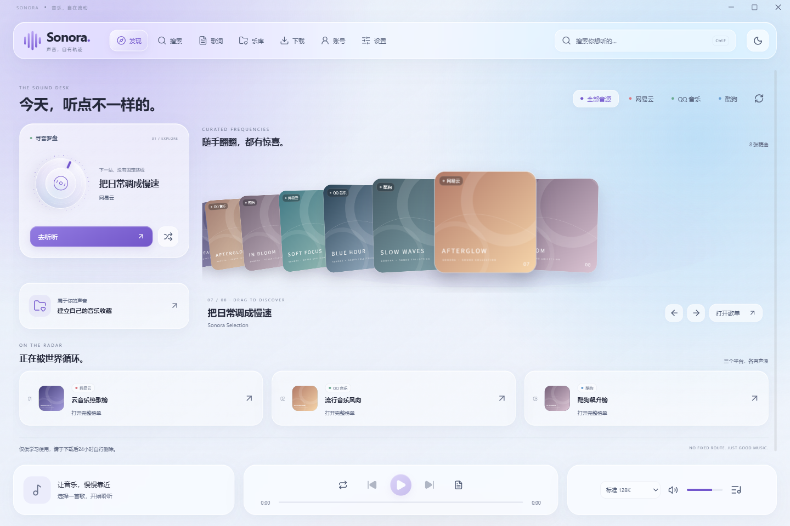
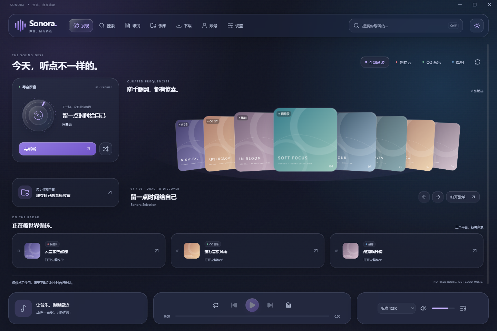

# Sonora 1.5.0

将整体界面重构为通透的音乐桌面，重新安排发现、导航、播放和管理页面，并加入由操作与播放状态驱动的动态交互。

## 音乐桌面与动态交互

- 顶部浮动导航带与全局搜索，选中位置的玻璃胶囊平滑移动；小窗口收为图标入口，保留名称提示和键盘访问。
- 发现页使用可拖拽的立体唱片轨道。支持鼠标、触控、横向触控板、Shift + 滚轮、左右方向键及 Home / End；点击选中唱片或“打开歌单”查看真实歌单。
- 寻音罗盘旋转挑选推荐，与唱片标题、平台和“去听听”联动；榜单与本地收藏入口组成桌面小组件。
- 底部播放信息、播放控制、音质与音量分为三个浮动玻璃面板。播放时有轻微呼吸动效，暂停时停止；右侧歌词 / 队列面板可平滑展开与收起。
- 当前封面成为低对比背景氛围，唱片跟随指针产生轻微景深；页面进入与选曲标题使用短过渡。不使用自动轮播，不将装饰动效描述为音频频谱。
- 统一浅色 / 深色、表格、弹窗、标签编辑器、账号与设置的材质、圆角、按钮和提示。继续显示实际音频规格，完整规格可在播放面板及悬停说明中查看。

## 可访问性与维护

“偏好与音源 → 玻璃与动效”可分别减少透明度和动态效果。默认遵循系统的减少动态效果设置；关闭动画后保留选择、拖拽和快捷操作。1080×740 小窗口可滚动查看内容，歌词面板展开时桌面组件自动调整布局。

UI 拆成导航、发现桌面、唱片轨道、播放器、聆听面板及过渡容器；样式拆分为基础内容、设计变量、材质、布局、页面、桌面与动效。平台适配器、音源配置、下载、标签写入和账号能力沿用原架构。已有账号、音乐库、接口配置及下载设置可继续使用。

这是 Electron 内部的玻璃材质与交互实现，不依赖 Windows 11 的原生 Mica / Acrylic，也不是 Apple 原生 Liquid Glass 渲染。

## 验证

新增 25 项真实 Electron 桌面检查，覆盖唱片拖拽与滚动、键盘边界、打开歌单、导航位置、播放状态动效、主题跟随、独立动效开关、减少动态效果、紧凑窗口、歌词 / 队列、导入、标签编辑及恢复弹窗，并加入 Windows 检查与发布流程。

验证使用本地生成的音乐、封面及隔离账号夹具，不使用个人账号或修改现有音乐。界面示意中的推荐与封面是测试夹具，实际运行显示接口返回内容。

最终通过 134 项核心测试和打包成品的 110 项桌面检查（原有 85 项 + 本版 25 项），无渲染器错误。生产构建、严格未使用代码检查、Jerry 随包校验及发布内容检查通过，依赖审计 0 漏洞。发布包未包含用户状态、测试目录或本机用户路径；主进程与接口配置和工作区源码一致。

仅供学习使用，请于下载后24小时自行删除。
