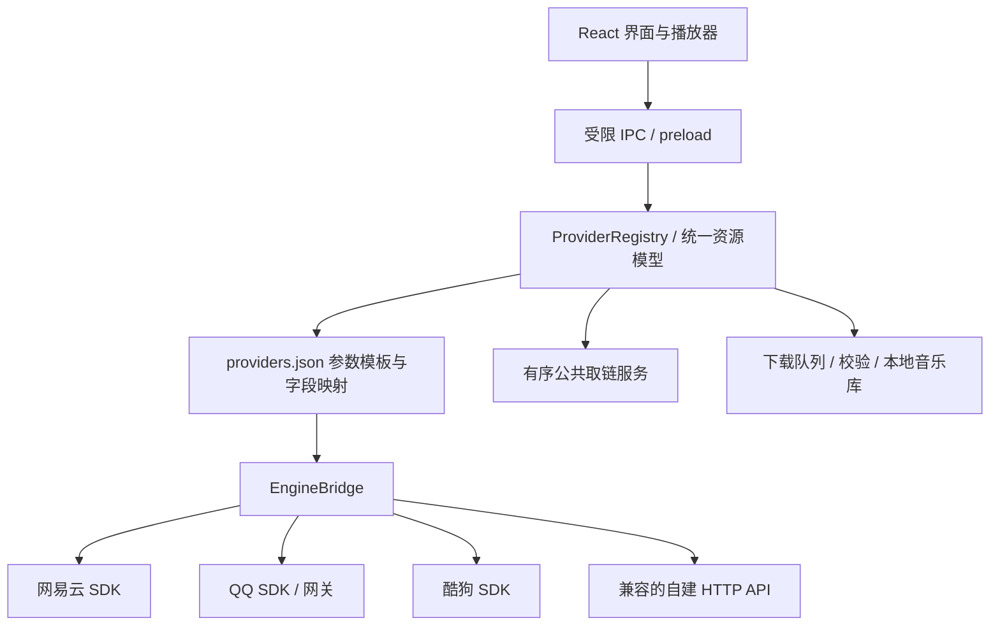

# Sonora 接口维护指南

## 1.1.0 歌词与手动音源配置

- 网易云增加可选的 `routes.lyricsWord`，默认 `module: lyric_new`、`path: /lyric/new`，失败或无歌词时回退 `routes.lyrics`。旧版内置默认路由自动升级；自建服务和自定义映射仍保留。
- 自定义 `routes.lyrics.lyricPaths` 在 original / translation / romanization 之外支持 `timed`（逐字文本）与 `ttml`（XML 字符串）的候选 JSON 路径。`routes.lyrics.lyricFormat` 可填 yrc / krc / qrc，决定 timed 文本的解析器。逐字数据从接口映射输入，UI 和下载器无须修改。
- 可选根字段 `lyricSources` 配置社区源 URL、directories 与 timeout。AMLL URL 可替换为兼容镜像，模板变量是 `{directory}` 与 `{id}`，无需改代码。QQ 索引使用歌曲 MID，网易云使用数值 ID。歌词源不发送用户 Cookie。
- `main/services/lyrics.mjs` 负责统一时间模型与导出。词时间统一为绝对毫秒，KRC 的相对词时间在解析时加上行开始时间；QRC 的解码模块与取词逻辑独立保存。
- 设置中的 `lyricSource` 可选 auto / platform / amll；amll 模式只支持库中已收录的网易云 / QQ 曲目。`lyricFormat` 可选 auto / lrc / elrc / ttml；auto 优先真实逐字。
- `preferredResolver` 可选 auto / builtin / resolver ID。auto 遵守 usePublicFallback 和服务顺序；指定服务直接调用该服务，失败不会默默换源，也不会调用内置账号接口。选择不支持当前平台的服务会明确报错。
- 修改接口配置会清除歌词缓存；正常歌词缓存最多约 100 条、有效期 5 分钟。

界面不直接请求音乐平台。搜索、榜单、歌单、播放、下载、歌词最终都经过 ProviderRegistry 和 EngineBridge，输出统一的资源模型。优先修改 JSON；仅当签名或登录协议改变时更新对应引擎。



## 1. 配置文件的位置和优先级

源码默认配置：`profiles/providers.json`。应用优先读取用户数据目录中的 `providers.json`；修改高级 JSON 或保存平台配置会写入该覆盖文件，立即生效。恢复内置配置会用默认配置覆盖运行时文件。

配置以 `schemaVersion: 1` 开头，包含 `platforms` 和 `resolvers`。JSON 编辑器会先验证后写入，不会把无效 JSON 应用到运行中的接口。

## 2. 平台配置

平台 ID 为 `netease`、`qq`、`kugou`；`engine` 对应内置引擎。`baseUrl` 为空时调用内置 SDK；填写后改为请求基础地址与 `routes[operation].path` 拼接得到的 HTTP API。

`enabled` 控制是否参与聚合；`trustRemoteCredentials` 控制是否向自建 HTTP 地址发送当前账号 Cookie，默认关闭。

操作路由包括：`search`、`charts`、`recommend`、`playlist`、`chart`、`album`、`artist`、`userPlaylists`、`resolve`、`download`、`lyrics`。

每条路由可配置：

| 字段 | 用途 |
|---|---|
| module | 内置引擎导出的函数名 |
| path | HTTP 模式请求路径，以 `/` 开头 |
| method | HTTP 模式的 GET 或 POST，默认 GET |
| params | 参数对象，支持嵌套参数和模板 |
| headers | HTTP 模式的自定义请求头；账号 Cookie 仍按信任设置决定是否自动传递 |
| items | 依次尝试的列表 JSON 路径 |
| mapping | 单个资源的字段映射 |
| fallbacks | 可选的备用路由，搜索路由可用 kinds 限定适用类型 |
| gateway | QQ 内置网关的 module / method / param 信封 |

路径以 `.` 分隔，例如 `data.songs`、`result.items`、`data.0.list`。列表路径必须对应数组。字段映射相对于列表中的每条记录。

可覆盖字段包括 `id`、`title`、`artist`、`album`、`cover`、`duration`、`trackCount`、`albumId`、`albumAudioId`、`mediaId`。QQ 的歌曲 MID 和 media MID 必须分别保留；酷狗的分类 ID 和真实 rankid 也不能混用。

## 3. 参数模板

整段为 `{key}` 时保留变量的数字 / 布尔类型；嵌入其他字符串时按字符串替换。没有脚本执行和 eval。

常用变量：`query`、`id`、`numericId`、`uid`、`type`、`page`、`limit`、`offset`、`duration`、`albumId`、`albumAudioId`、`mediaId`、`level`、`br`、`kbps`、`qqQuality`、`kgQuality`、`freePart`、`metingPlatform`。

`searchTypes` 定义搜索类别到平台参数的映射。`duration` 查询变量使用毫秒。平台 Cookie 不进入模板变量，因此不会因公共服务的普通模板配置而自动泄漏。

示例：某自建服务将搜索改为 POST `/v2/search`，返回 `payload.tracks`：

```json
{
  "module": "cloudsearch",
  "path": "/v2/search",
  "method": "POST",
  "params": {"keyword": "{query}", "category": "{type}", "page": "{page}", "size": "{limit}"},
  "items": ["payload.tracks"],
  "mapping": {
    "id": "song_id",
    "title": "song_title",
    "artist": "singer_name",
    "cover": "artwork",
    "duration": "seconds",
    "mediaId": "file.media_key"
  }
}
```

把上述对象替换进对应平台的 `routes.search`，填写该服务的 baseUrl，再保存即可。改变外部接口结构不会影响播放器和下载队列。

## 4. 自定义音频地址与歌词结构

`resolve` 和 `download` 路由可增加以下字段，路径相对于去掉 SDK body / response 包装后的整个响应：

```json
{
  "urlPaths": ["payload.files.0.link", "payload.url"],
  "bitratePaths": ["payload.kbps"],
  "sizePaths": ["payload.bytes"],
  "trialPaths": ["payload.is_preview"]
}
```

不配置时使用平台内置解析。urlPaths 对应字符串 URL 或 URL 数组。码率可返回 kbps 或 bps；标记值 `false`、`0`、`"0"`、`"false"`、`"null"` 被视为非试听。建议在两个路由中同时配置，因为播放和下载可能使用不同接口。

如果新的歌词服务直接返回文本字段，可在 lyrics 路由增加：

```json
{
  "lyricPaths": {
    "original": ["payload.original_lrc"],
    "translation": ["payload.translated_lrc"],
    "romanization": ["payload.roman_lrc"]
  }
}
```

没有 lyricPaths 时，酷狗仍使用「检索歌词候选 → 获取 accesskey → 下载 LRC」的两步协议。

## 5. 增加或更换公共取链服务

resolvers 按数组顺序执行，只有平台主要接口取链失败、且备用开关启用时才尝试。支持：

- `mode: "redirect"`：响应必须为 HTTP 3xx，读取 Location。
- `mode: "json"`：按照 urlPaths 读取播放地址，可附加 bitratePaths 和 sizePaths。

```json
{
  "id": "my-provider",
  "name": "我的备用接口",
  "enabled": true,
  "platforms": ["netease", "qq", "kugou"],
  "mode": "json",
  "url": "https://example.com/music",
  "params": {"platform": "{metingPlatform}", "id": "{id}", "br": "{kbps}"},
  "urlPaths": ["data.url"],
  "bitratePaths": ["data.bitrate"],
  "sizePaths": ["data.size"]
}
```

可选 headers 用于该服务自己的 API Key。手工写入 headers 的值保存在本机配置文件中，不受账号 Cookie 的系统加密保护；不要将带 Key 的配置公开分享。诊断导出不会导出这些请求头。

按关键词匹配的服务需设置 strictMatch、titlePaths、artistPaths，防止把其他歌曲当成目标资源。此类服务无法仅凭标题保证录音版本相同，因此慕名 QQ 候选默认关闭。ID 精确解析应优先于关键词匹配。

默认保留 [Injahow](https://api.injahow.cn/meting/index.php)、[铭心](https://api.mxin.me/api/docs/detail/api/v1/music)、[Sakurink](https://apivc-meting.sakurink.eu.org/registration/) 和 [慕名 QQ](https://xiaoapi.cn/detail/19) 的配置。注册型服务需要使用者自己的服务密钥；不共享其他人的账号权益。

## 6. 需要改源码的情况

1. 签名、加密或扫码协议变化：更新对应 SDK 或 vendor/kugou；必要时修改 `main/providers/engines.mjs`。
2. 返回结构无法通过字段映射表示：在 `main/core/models.mjs` 增加对应正规化函数，并补实际响应样本测试。
3. 增加全新平台：扩展平台注册、Platform 类型、名称与登录适配；通用播放器、下载队列和本地库可复用。当前运行时配置只注册三个目标平台，并非执行任意 JavaScript 的插件系统。

网易云引擎：[NeteaseCloudMusicApiEnhanced/api-enhanced](https://github.com/NeteaseCloudMusicApiEnhanced/api-enhanced)。QQ 引擎：[sansenjian/qq-music-api](https://github.com/sansenjian/qq-music-api)。酷狗引擎：[MakcRe/KuGouMusicApi](https://github.com/MakcRe/KuGouMusicApi)，当前固定提交见 THIRD-PARTY-NOTICES。

## 7. 验证修改

先使用设置页的「测试已保存配置」验证歌曲搜索，再测试对应操作；搜索通过不代表下载一定可用。

```powershell
npm test
npm run test:e2e
npm run test:live
npm run package
```

不要用 HTTP 200 作为唯一成功条件。需检查业务状态、资源 ID、音频 URL、文件头、传输大小与时长。新版本已覆盖错误页伪装为音频、明显试听片段、文件名冲突、暂停重试和 Cookie 传递边界等测试。
